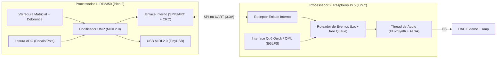

# Arquitetura e Requisitos do Sistema — Etapa 01.2 e 01.4

## 1. Requisitos do Sistema

### 1.1 Requisitos Funcionais (RF)
- **RF01:** Operar de forma 100% autônoma (sem PC, internet ou DAW externa).
- **RF02:** Capturar pressionamento e soltura de teclas físicas com anti-ghosting e debounce.
- **RF03:** Medir velocidade de acionamento (velocity) quando o mecanismo físico possuir duplo contato.
- **RF04:** Ler pedais (sustain/expressão), encoders e potenciômetros.
- **RF05:** Gerar e transmitir eventos musicais no formato UMP (MIDI 2.0), com compatibilidade MIDI 1.0 via USB.
- **RF06:** Sintetizar áudio polifônico em tempo real a partir de SoundFonts (`.sf2`/`.sf3`) via FluidSynth.
- **RF07:** Permitir seleção de instrumentos, ajustes de volume, mixer, efeitos (reverb, chorus) e configurações via tela touchscreen.
- **RF08:** Exibir diagnósticos do sistema (status de comunicação, CPU, XRUNs, versões).

### 1.2 Requisitos Não Funcionais (RNF — Metas Mensuráveis)
*Nota: Todos os valores abaixo são **metas de projeto**, não resultados medidos.*

| Métrica | Meta Alvo |
| :--- | :--- |
| Frequência de varredura de teclas (RP2350) | >= 1.000 Hz (período <= 1 ms) |
| Latência ponta a ponta (tecla física -> áudio DAC) | < 10 ms |
| Jitter de varredura | < 100 µs |
| Polifonia simultânea (RPi 5) | >= 64 vozes sem dropouts |
| Ocorrências de underrun (XRUNs) | 0 em operação normal |
| Perda de eventos na comunicação interna | 0% (com detecção de erro via CRC) |
| Tempo de boot até aplicação pronta (RPi 5) | < 15 s (meta inicial) |

### 1.3 Restrições do MVP
- Firmware inicial **single-core** no RP2350 (dual-core somente após estabilização).
- Motor de síntese inicial baseado em **FluidSynth** (DSP próprio apenas em etapas futuras).
- Interface inicial focada em tela principal, biblioteca de instrumentos, teclado virtual e mixer básico.
- Sem gravação de áudio/MIDI ou sequenciador no MVP.

---

## 2. Arquitetura de Componentes

## 3. Fluxo de Eventos Musicais e Thread-Safety

1. **Aquisição (RP2350):** A varredura matricial detecta mudança de estado da tecla, aplica debounce e calcula velocity.
2. **Codificação:** O evento é convertido em pacote **UMP** (32 ou 64 bits).
3. **Transporte:** O pacote UMP é encapsulado em um frame com cabeçalho, tamanho e **CRC-8/CRC-16** e enviado ao Raspberry Pi 5 (além de poder ser espelhado para a porta USB MIDI 2.0).
4. **Recepção e Roteamento (RPi 5):** Uma thread dedicada de I/O lê o enlace, valida o CRC e insere o evento UMP em uma **fila lock-free SPSC** (*Single-Producer, Single-Consumer* ou MPSC) para a thread de áudio.
5. **Síntese (RPi 5 — Thread de Áudio):** A thread de áudio (`SCHED_FIFO`) consome os eventos da fila sem mutexes bloqueantes, sem alocação dinâmica e sem I/O de disco, alimentando o FluidSynth e escrevendo no buffer ALSA/I²S.
6. **Interface (RPi 5 — Thread GUI):** A UI QML comunica-se com o backend C++ via `Q_PROPERTY` / sinais, enviando comandos de troca de preset ou volume por fila assíncrona, nunca bloqueando a thread de áudio.

## 4. Estratégia de Testes

- **Testes Unitários (Host x86_64):** Lógica pura em C++ (debounce, matriz virtual, codificação/decodificação UMP, framing + CRC, ring buffer lock-free).
- **Testes de Integração:** Loopback de protocolo, injeção de eventos UMP no FluidSynth em modo headless/file-output.
- **Testes Físicos (com hardware):** Osciloscópio/analisador lógico para latência tecla->DAC, medição de XRUNs no ALSA e enumeração USB MIDI 2.0 em Linux/macOS.
